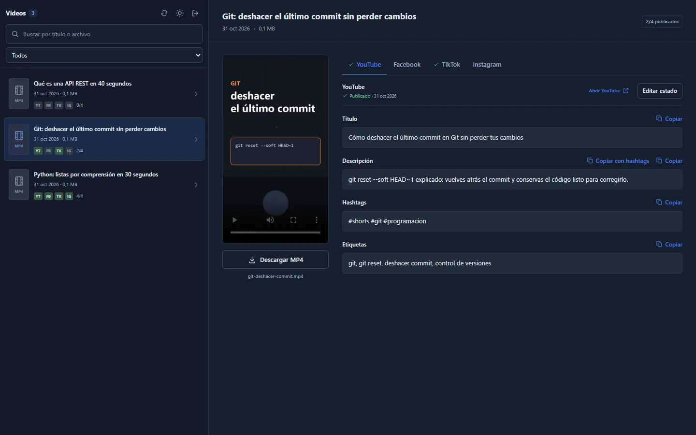

<!-- ============ HEADER ============ -->
<p align="center">
  
</p>

<p align="center">
  <a href="https://portafolio.enzocode.dev">
    
  </a>
</p>

<p align="center">
  <a href="https://portafolio.enzocode.dev"></a>
  <a href="https://www.linkedin.com/in/sergiocanomejia/"></a>
  <a href="mailto:contacto@enzocode.dev"></a>
  <a href="https://wa.me/573504928148"></a>
  
</p>

---

## 👋 About me

I'm **Sergio Cano**, a **Full Stack Developer** from 🇨🇴 Colombia, building web applications and platforms professionally since **2021**. I enjoy shipping complete products — from database and API design to polished, responsive interfaces — that solve real problems.

I work with **AI-assisted development**, using **Claude**, **Codex** and **Hermes** to plan, write and review code. AI speeds up the process; I make the decisions and validate the result.

- 🧑‍💻 **Currently:** building full stack web apps and platforms
- 🤖 **AI workflow:** Claude · Codex · Hermes
- 🎓 **Studying:** Software Analysis & Development (Technologist degree)
- 🗣️ **Building:** [Speak English Enzo](https://speak-english-enzo.enzocode.dev), an app to practice everyday English phrases
- 💼 **Open to:** freelance projects and new opportunities
- 📫 **Reach me:** [contacto@enzocode.dev](mailto:contacto@enzocode.dev) · [WhatsApp](https://wa.me/573504928148)
- 🌐 **Portfolio:** [portafolio.enzocode.dev](https://portafolio.enzocode.dev)

```js
const sergio = {
  role: "Full Stack Developer",
  experience: "2021 → present",
  frontend: ["React", "Next.js", "Angular", "Vue", "React Native", "Flutter"],
  backend: ["Node.js", "Laravel", "Symfony", "Spring Boot", ".NET", "Python"],
  databases: ["PostgreSQL", "MySQL", "MongoDB"],
  devops: ["Docker", "Linux", "GitHub Actions", "Vercel"],
  ai: ["Claude", "Codex", "Hermes"],
  languages: ["Spanish (native)", "English"],
};
```

---

## 🛠️ Tech stack

<table align="center">
  <tr>
    <td align="center" width="140"><b>Languages</b></td>
    <td></td>
  </tr>
  <tr>
    <td align="center"><b>Frontend</b></td>
    <td></td>
  </tr>
  <tr>
    <td align="center"><b>Backend</b></td>
    <td></td>
  </tr>
  <tr>
    <td align="center"><b>Databases</b></td>
    <td></td>
  </tr>
  <tr>
    <td align="center"><b>DevOps & Tools</b></td>
    <td></td>
  </tr>
  <tr>
    <td align="center"><b>AI-assisted dev</b></td>
    <td>
      
      
      
    </td>
  </tr>
</table>

---

## 🚀 Featured projects

<table>
  <tr>
    <td width="50%" valign="top">
      <h3>🗣️ Speak English Enzo</h3>
      <p>My project to <b>practice everyday English phrases</b> out loud. You get a phrase with its translation, listen to how it sounds, repeat it into the mic, and the app scores your pronunciation — you only move on after hitting 80&nbsp;% accuracy twice in a row. Real-life phrases organized in sets, with word-by-word meaning and slow playback. Built with AI-assisted development.</p>
      <p>
        <a href="https://speak-english-enzo.enzocode.dev"><b>🌐 Live app</b></a> ·
        <a href="https://github.com/EnzoCodeDev/speak-english-enzo"><b>💻 Source code</b></a>
      </p>
      
      
      
    </td>
    <td width="50%" valign="top">
      <h3>💼 Personal portfolio</h3>
      <p>My personal website under the <b>enzoCodev</b> brand — web development + AI. A minimalist dark design with a side menu that showcases my projects, stack, experience and contact info. Built with AI-assisted development.</p>
      <p>
        <a href="https://portafolio.enzocode.dev"><b>🌐 Live site</b></a> ·
        <i>🔒 Private repository</i>
      </p>
      
      
      
    </td>
  </tr>
  <tr>
    <td colspan="2" valign="top">
      <h3>🎬 enzo-videos</h3>
      <p>A <b>private panel to manage the publishing of my short videos</b> on YouTube, Facebook, TikTok and Instagram. Videos arrive only from my AI-assisted editing workflow over SSH — there is no web upload — each one with its own title, description and hashtags tailored to every network (plus YouTube tags and TikTok cover text). In the panel I copy the read-only text, publish on each platform and mark its status; the publish date is stored per network. Email one-time-code sign-in, SQLite storage and light/dark mode.</p>
      <picture>
        <source media="(prefers-color-scheme: dark)" srcset="./assets/enzo-videos-dark.webp" />
        <source media="(prefers-color-scheme: light)" srcset="./assets/enzo-videos-light.webp" />
        
      </picture>
      <p><i>🔒 Private tool · private repository</i> · screenshot with demo data</p>
      
      
      
      
      
    </td>
  </tr>
</table>

---

## 📊 GitHub stats

<p align="center">
  
  
</p>

<p align="center">
  
</p>

<p align="center">
  
</p>

<!-- Snake generated by .github/workflows/snake.yml (branch "output") -->
<p align="center">
  <picture>
    <source media="(prefers-color-scheme: dark)" srcset="https://raw.githubusercontent.com/EnzoCodeDev/EnzoCodeDev/output/github-snake-dark.svg" />
    <source media="(prefers-color-scheme: light)" srcset="https://raw.githubusercontent.com/EnzoCodeDev/EnzoCodeDev/output/github-snake.svg" />
    
  </picture>
</p>

---

<p align="center">
  <b>Got a project in mind or an opportunity?</b> Email me at
  <a href="mailto:contacto@enzocode.dev">contacto@enzocode.dev</a>, message me on
  <a href="https://wa.me/573504928148">WhatsApp (+57 350 492 8148)</a> or check out my
  <a href="https://portafolio.enzocode.dev">portfolio</a>. 🤝
</p>

<p align="center">
  
</p>
